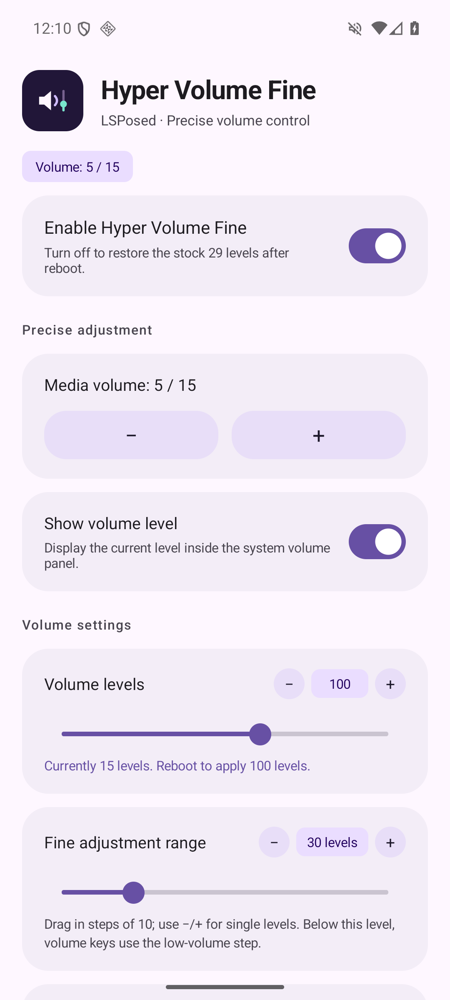
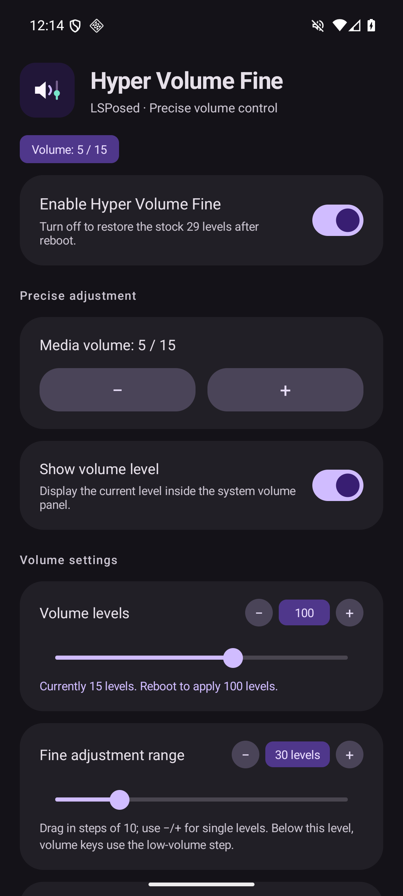

<p align="center">
  
</p>

# Hyper Volume Fine — English edition

**Finer media volume control for Xiaomi / HyperOS, with 100 configurable levels instead of the stock 29.**

An English fork of [USAMA6878786/HyperVolumeFine](https://github.com/USAMA6878786/HyperVolumeFine), with translated app text, documentation, build messages, source comments, and a new adaptive launcher icon. The original MIT license and package identity are preserved.

LSPosed module · Root required · libxposed **API 102** · Scope: **System Framework + System UI**

[](LICENSE)
[](https://github.com/mexusbg/HyperVolumeFineEN)

## Features

- **100 media volume levels by default**, configurable from **20 to 150** in the app. The module changes the framework maximum and the maximum supplied to audio policy.
- **Fine control at low volume:** below level 30, volume keys move one level per press by default; at or above the threshold they move four levels. Both step sizes are configurable.
- **Slider snapping:** align absolute volume changes to a configurable grid. See the [review notes](docs/OPTIMIZATIONS.md#3-correct-the-slider-snapping-units) for an inherited mismatch between the documented grid size and internal indices.
- **An in-panel volume number:** display the current media level inside the system volume panel, below the three-dot icon. No separate overlay window is used.
- **Material 3 style settings**, automatic light/dark themes, live volume controls, sliders, single-level −/+ buttons, and debounced reboot reminders.
- **Adaptive launcher icon**, including a round-icon entry and Android 13+ monochrome themed-icon support. The same mark appears in the settings header.

| English settings — light | English settings — dark |
|---|---|
|  |  |

These settings screenshots are from an Android 16 emulator without LSPosed, so they show its stock 15-level maximum. They demonstrate the translated interface, not functioning system hooks.

<p align="center">
  
</p>

The volume-panel screenshot is retained from upstream; it contains no text requiring translation.

## Installation

1. Build the APK using the instructions below, or download an English APK if one is available on this fork's [Releases page](https://github.com/mexusbg/HyperVolumeFineEN/releases).
2. Install `HyperVolumeFineEN-2.10-en.1.apk`.
3. Open **LSPosed** and enable **Hyper Volume Fine**.
4. Select both **System Framework** (`system`) and **System UI** (`com.android.systemui`) in the scope.
5. Reboot the phone, then open the app and check that **Enable Hyper Volume Fine** is on.

The default is 100 levels. Changing the level count requires a reboot because it is read during `AudioService` initialization. Fine/coarse steps, the threshold, slider snapping, and number visibility can change without rebooting, subject to short configuration caches.

The package remains `io.github.usama6878786.hypervolumefine`. A locally built APK has a different signing certificate from upstream, so Android will normally require uninstalling the upstream app before installing this build. Follow the disabling precautions below before switching builds.

### Disabling precautions and inherited limitations

The upstream procedure is to turn off the app's enable switch, reboot with the module still enabled in LSPosed so its restoration routine runs, and only then disable it in LSPosed. Disabling it directly can cause saved values from the expanded range to be clamped to the stock maximum at the next boot.

**Code review found defects in that restoration routine:** it uses a fixed 29/100 ratio, only rescales values above 29, and includes the module's own `volume_fine_*` keys in its scan. The English edition preserves the hook behavior; it does not claim to fix those defects. Keep playback stopped and media volume low when switching or disabling, and read the [priority fixes](docs/OPTIMIZATIONS.md) before relying on restoration across devices or custom level counts.

## Compatibility

**Tested by the fork maintainer on Xiaomi 17 Ultra, EEA variant, running HyperOS 4 / Android 17.**

Upstream also reports development and hardware testing on **Xiaomi 13 (`fuxi`) / HyperOS 4.0 / Android 17**. The Xiaomi 13 results are upstream reports.

The implementation depends on `AudioService`, `ro.config.media_vol_steps`, and `VolumeStreamState`. Upstream expects the general approach to work on many Android 13+ devices. The test reports above do not establish compatibility with other devices or ROM variants. The manifest minimum is Android 9/API 28; that does not establish hook compatibility on every supported install version.

The volume-number positioning relies on MIUI/HyperOS view classes such as `MiuiVolumeSeekBar`. Unsupported panel implementations may not show the number. Audio routing and saved volume levels are device-specific, so a newly connected headset or Bluetooth device can have a different volume from the speaker.

## Frequently asked questions

**Why did changing the level count do nothing?** Reboot. The maximum is set when `AudioService` is constructed and read once at boot.

**Why is there no number in the volume panel?** Check that System UI is selected in LSPosed, reboot, and enable **Show volume level**. The panel hooks are designed around MIUI/HyperOS views.

**Does this affect alarms or calls?** The default stream list is media only (`STREAM_MUSIC`, stream type 3). Other streams retain their stock behavior unless explicitly added to the configured stream list.

**Why do settings revert after reopening the app?** Changes are broadcast to the module inside `system_server`, which writes `Settings.System`. If the module is inactive, the screen can change in memory without saving. There is currently no save acknowledgment; see the review notes.

**Does this change the vendor loudness curve?** No. It changes how many indices traverse the existing curve. The vendor curve in `/vendor/etc/audio_policy_volumes.xml` still determines loudness.

## Build

The project uses **aapt2 + javac + d8 + zipalign + apksigner**, without Gradle.

Requirements:

- JDK 17, Python 3, and Bash (Git Bash on Windows).
- Android SDK platform **36** and build tools **36.0.0**.
- The `classes.jar` from the official [libxposed API 102.0.0](https://github.com/libxposed/api) AAR, used at compile time only.

Download and extract the dependency in Bash:

```bash
mkdir -p .toolchain
curl --fail --location \
  https://repo.maven.apache.org/maven2/io/github/libxposed/api/102.0.0/api-102.0.0.aar \
  -o .toolchain/libxposed-api.aar
python -c "import zipfile; z=zipfile.ZipFile('.toolchain/libxposed-api.aar'); open('.toolchain/libxposed-api.jar','wb').write(z.read('classes.jar'))"
```

Build with an installed SDK:

```bash
export JAVA_HOME="/path/to/jdk-17"
export ANDROID_HOME="/path/to/Android/Sdk"
export BUILD_TOOLS=36.0.0
export LIBXPOSED="$PWD/.toolchain/libxposed-api.jar"
bash build.sh
```

On Windows, use Git Bash and paths such as `C:/Program Files/Eclipse Adoptium/jdk-17...` and `C:/Users/your-user/AppData/Local/Android/Sdk`. Existing `JAVA_HOME` and `ANDROID_HOME` values can be reused.

Output: **`dist/HyperVolumeFineEN-2.10-en.1.apk`**. Override it with `OUT_DIR=/path/to/output`. `ANDROID_PLATFORM` defaults to `android-36`; `ANDROID_JAR` can override the platform JAR directly. The build reads version metadata from the manifest.

Alternatively, the original local-toolchain layout is supported via `TOOLCHAIN=/path`: `jdk/jdk-*/bin`, `bt/android-*/`, `plat/android-*/android.jar`, and `libxposed-api.jar`.

The script creates a **development signing key** in `.keystore/` and retains it across builds so subsequent local APKs can update each other. `KEYSTORE` can select another compatible keystore; the script currently expects alias `androiddebugkey` and password `android`. Keys and build artifacts are ignored by Git. Configure separate release signing before publishing production APKs.

## Command-line configuration

Run these through an authorized adb connection:

```bash
adb install -r --no-incremental dist/HyperVolumeFineEN-2.10-en.1.apk
adb shell settings put system volume_fine_steps 100       # App range: 20–150; reboot
adb shell settings put system volume_fine_threshold 30    # Fine steps below this level
adb shell settings put system volume_fine_fine 1          # Low-volume step: 1–6
adb shell settings put system volume_fine_coarse 4        # App range: 1–8
adb shell settings put system volume_fine_snap 2          # 1 disables snapping
adb shell settings put system volume_fine_show_number 1   # 0 hides the number
adb shell settings put system volume_fine_enabled 1       # 0 disables; reboot
adb shell settings put system volume_fine_debug 0         # 1 enables diagnostic logs
```

The hook accepts a slightly wider range than the app for some parameters: 15–150 total levels and 1–10 coarse steps. The default stream list is `"3"`; advanced users can change `volume_fine_streams` (for example `"2,3,4,5"`) and reboot. Additional streams have not been validated by this fork.

The manifest retains upstream's `WRITE_SETTINGS` declaration. Custom configuration keys are persisted by the module in `system_server`, not directly by the settings activity; granting ordinary modify-system-settings access does not replace an active module.

## Development notes

- [Implementation and upstream hardware findings](docs/IMPLEMENTATION.md)
- [Prioritized optimization and correctness suggestions](docs/OPTIMIZATIONS.md)
- [Validation performed for this English edition](docs/VALIDATION.md)
- [Editable SVG icon](docs/app-icon.svg); Android vector and adaptive resources live in `res/`.

```text
AndroidManifest.xml                  Package, version, theme, launcher icons
build.sh                             Standalone APK build
res/values/strings.xml                English UI strings and plurals
res/values{,-night}/                  Material 3 colors and themes
res/drawable/                        UI shapes and launcher vectors
res/mipmap-anydpi-v{26,33}/           Adaptive, round, and themed icon entries
src/main/java/io/github/usama6878786/hypervolumefine/
    VolumeFineModule.java            system_server hooks and configuration
    PanelNumber.java                 SystemUI panel number
    SettingsActivity.java            Programmatic settings layout
    M3Switch.java                    Custom Material 3 switch
src/main/resources/META-INF/xposed/
    module.prop                      minApiVersion=102, targetApiVersion=102
    java_init.list                   Module entry class
    scope.list                       system + com.android.systemui
```

## License

[MIT](LICENSE). Original copyright: **2026 USAMA6878786**.
